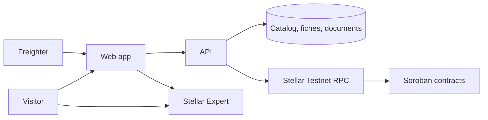
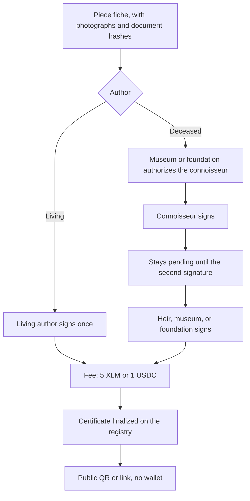
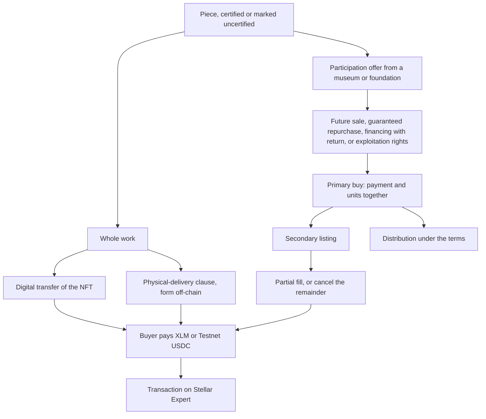

# Architecture

Artifex on Stellar Testnet. The diagrams match the running Scale deployment: a web app, an API, and Soroban contracts. Host layout, ports, and operational paths are not part of this document.

Identifiers for the contracts and the project accounts are generated in [CONTRACTS.md](../CONTRACTS.md) and [WALLETS.md](../WALLETS.md).

## Components

The visitor can browse and verify with no wallet. Freighter is required to sign a certification, a purchase, a listing, or a trustline. The API prepares the transaction. The signer approves it. The contracts record the result. Stellar Expert is the public receipt.

The contracts are: roles, connoisseur authorization, certificate registry, fee collector, whole-work NFT, participation, marketplace, and distribution. Payments use the Stellar asset contracts for XLM and for Testnet USDC.

## Certification

A living author signs once. A deceased author needs two signatures: the connoisseur, and one of the heir, a museum, or a foundation. The museum or foundation authorizes the connoisseur before that connoisseur can sign. The fee is 5 XLM or 1 USDC, collected before the certificate is finalized.

Digitizing an existing certificate is the same registry, with the prior document hash on the fiche.

Verification reads the registry. It shows the signers. A fiche that was never finalized is shown as not certified, including when it is offered for sale.

## Sale

Two sale shapes share the marketplace. A whole work transfers the NFT. A participation transfers units of one of the four types. Both settle in XLM or Testnet USDC. Primary participation sales deliver the units in the same contract call as the payment. Secondary listings can be filled in part.

Distribution follows the terms hash stored for that offer. Burning or retiring units is part of that policy, and it does not revoke the certificate.
